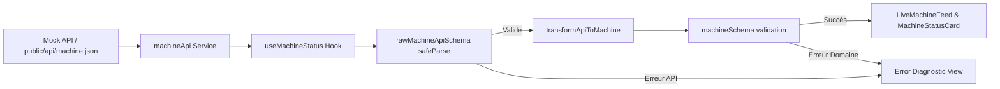

# Requirements

### Overview & Goals
L'objectif est d'alimenter le composant de statut machine à partir d'un flux de données API asynchrone (illustré par `public/api/machine.json`), tout en garantissant un niveau maximal de fiabilité, de disponibilité et de transparence diagnostique.

Dans une perspective d'utilité maximale pour le système et les opérateurs :
- Chaque bit de donnée entrant doit être validé à la frontière du système pour éradiquer tout risque de corruption d'état ou de crash UI.
- L'expérience utilisateur doit minimiser les frictions cognitives en offrant des états de chargement non bloquants, des mécanismes de reconnexion / actualisation instantanés, et un affichage explicite des erreurs.

### Scope
- **In Scope :**
  - Schématisation Zod du contrat de données de l'API brute (`public/api/machine.json`).
  - Fonction de normalisation et d'adaptation (`adapter/transformer`) entre la structure imbriquée de l'API et le modèle de composant `Machine`.
  - Service de récupération HTTP avec gestion des annulations (`AbortController`) et des codes d'erreur.
  - Hook réactif `useMachineStatus` avec gestion du cycle de vie (`loading`, `error`, `data`, `refetch`, polling configurable).
  - Composant UI connecté avec indicateurs d'état (chargement, erreur réseau, erreur de schéma, données nominales) et contrôles opérateur.
  - Suite de tests unitaires et d'intégration automatisés.
- **Out of Scope :**
  - Mise en place d'un serveur backend réel (Node/Express/Nest) — le flux consomme le mock JSON statique servi par Vite.
  - Modification des règles de validation intrinsèques de `src/schemas/machine.schema.ts`.

### User Stories
- **En tant qu'opérateur industriel**, je veux visualiser en temps réel l'état actualisé de la machine sans recharger la page afin de détecter immédiatement toute dérive ou anomalie.
- **En tant qu'opérateur**, je veux voir un retour immédiat en cas d'interruption du flux ou de données invalides afin d'agir sans délai de diagnostic.
- **En tant que développeur**, je veux que les données de l'API soient validées et typées à la frontière pour garantir la stabilité du code et simplifier la maintenance.

### Functional Requirements
- **FR-1 (Ingestion & Validation) :** Valider la structure brute de l'API avec Zod dès sa réception. Rejeter les payloads incomplets ou altérés avec un rapport d'erreurs détaillé.
- **FR-2 (Transformation) :** Extraire les champs cibles (`sensors.temperature.value` -> `temperatureC`, `statusDetails.currentPhase` -> `currentPhase`, etc.) pour alimenter le modèle `Machine`.
- **FR-3 (États asynchrones) :** Gérer explicitement 4 états d'interface : Chargement initial, Données valides affichées, Erreur réseau/HTTP, Erreur de validation de schéma.
- **FR-4 (Actualisation & Contrôle) :** Fournir un déclencheur manuel de rafraîchissement (`Refetch`) et une option d'auto-rafraîchissement périodique (polling).
- **FR-5 (Cohabitation de l'interface) :** Permettre de basculer ou d'afficher conjointement le flux API en direct et le bac à sable de test manuel.

### Non-Functional Requirements
- **Fiabilité :** 0 crash applicatif en cas de payload corrompu ou de panne réseau.
- **Performance :** Transformation et validation en mémoire sans saccade UI (< 5ms).
- **Auditabilité & Déboguage :** Journalisation claire des échecs de validation Zod en console et restitution synthétique dans l'interface.

# Technical Design

### Current Implementation
L'application actuelle dispose de :
- Un schéma Zod validé unitairement dans `src/schemas/machine.schema.ts` (modèle plat `Machine`).
- Une carte d'affichage `MachineStatusCard.jsx` prête à recevoir un objet conforme `Machine`.
- Un bac à sable `ManualTester.jsx` dans `App.jsx` servant d'environnement d'expérimentation statique.
- Un mock de production complet dans `public/api/machine.json` contenant des structures imbriquées (`location`, `statusDetails`, `sensors`, `alarms`, `production`, `maintenance`).

### Key Decisions
1. **Validation en deux étapes (API Ingestion -> Transformation -> Modèle Domaine) :**
   - *Choix :* Valider d'abord le payload brut avec un schéma API (`rawMachineApiSchema`), puis mapper les propriétés vers `machineSchema` (ou valider directement via un schéma Zod avec `z.preprocess`/`transform`).
   - *Bénéfice :* Garantit la conformité du contrat d'API externe tout en conservant l'indépendance et la réutilisabilité du composant UI `MachineStatusCard`.
2. **Hook React personnalisé `useMachineStatus` :**
   - *Choix :* Découpler la logique réseau et la gestion d'état du rendu visuel.
   - *Bénéfice :* Réutilisabilité, testabilité isolée sans montage complexe de composants, facilité d'intégration de fonctionnalités comme le polling ou l'annulation de requêtes.
3. **Gestion d'erreur granulaire :**
   - *Choix :* Différencier l'erreur réseau (serveur inaccessible), l'erreur HTTP (404/500) et l'erreur de schéma Zod (données corrompues).
   - *Bénéfice :* Réduit le temps de résolution d'incident pour les opérateurs et les ingénieurs.

### Proposed Changes
1. **Création de `src/schemas/machine-api.schema.ts` :** Définition du schéma API et de la fonction d'adaptation `transformApiToMachine`.
2. **Création de `src/services/machineApi.ts` :** Service de communication réseau avec gestion des requêtes HTTP.
3. **Création de `src/hooks/useMachineStatus.ts` :** Hook de cycle de vie de la donnée API.
4. **Création de `src/components/LiveMachineFeed.jsx` :** Composant UI intégrant la vue connectée, les états de chargement, d'erreur et de contrôle.
5. **Mise à jour de `src/App.jsx` et `src/App.css` :** Intégration de la vue Live aux côtés du testeur manuel.

### Data Models / Contracts

```typescript
// Schéma Zod du flux API brut
export const rawMachineApiSchema = z.object({
  id: z.number().int().positive(),
  name: z.string().trim().min(1),
  status: z.enum(['running', 'stopped', 'maintenance', 'error']),
  statusDetails: z.object({
    currentPhase: z.number().int().positive(),
    totalPhases: z.number().int().positive(),
    elapsedMinutes: z.number().min(0).finite(),
    currentMode: z.string().optional(),
    loadPercentage: z.number().optional(),
  }),
  sensors: z.object({
    temperature: z.object({
      value: z.number().finite(),
      unit: z.string().optional(),
    }),
  }),
  lastUpdated: z.string().datetime({ offset: true }),
})

export type RawMachineApi = z.infer<typeof rawMachineApiSchema>

// Signature de la fonction de transformation
export function transformApiToMachine(raw: RawMachineApi): Machine {
  return {
    id: raw.id,
    name: raw.name,
    status: raw.status,
    temperatureC: raw.sensors.temperature.value,
    currentPhase: raw.statusDetails.currentPhase,
    totalPhases: raw.statusDetails.totalPhases,
    elapsedMinutes: raw.statusDetails.elapsedMinutes,
    updatedAt: raw.lastUpdated,
  }
}
```

### Architecture Diagram



### File Structure
- `src/schemas/machine-api.schema.ts` (Nouveau : contrat API & transformateur)
- `src/schemas/machine-api.schema.test.ts` (Nouveau : tests du contrat API)
- `src/services/machineApi.ts` (Nouveau : client HTTP)
- `src/hooks/useMachineStatus.ts` (Nouveau : hook réactif)
- `src/components/LiveMachineFeed.jsx` (Nouveau : composant UI connecté)
- `src/App.jsx` (Modifié : ajout du composant flux direct et sélecteur de mode)
- `src/App.css` (Modifié : styles pour le flux direct, skeletons et états réseau)

### Risks & Mitigations
- **Désynchronisation entre API et schéma UI :** Le schéma API brut et le transformateur interceptent toute divergence et la remontent immédiatement sans corrompre le composant graphique.
- **Requêtes concurrentes ou non résolues (Race Conditions) :** Utilisation d'`AbortController` dans le hook pour annuler les requêtes en vol lors du démontage ou du re-déclenchement.

# Testing

### Validation Approach
La vérification de la solution s'appuie sur une pyramide de tests automatisés et une validation visuelle interactive :
1. **Tests unitaires de validation et transformation :** Couverture exhaustive des règles de validation de l'API brute et de la fonction d'adaptation avec Vitest.
2. **Tests d'intégration du service & hook :** Simulation des appels réseau avec `fetch` mocké (réponses 200, 404, 500, JSON corrompu).
3. **Validation manuelle / UI :** Vérification dans l'application que les données de `public/api/machine.json` s'affichent correctement et que les boutons d'actualisation et de polling fonctionnent sans friction.

### Key Scenarios
- **Scénario 1 (Chargement nominal de l'API) :** L'appel à `/api/machine.json` réussit, le payload est validé et transformé, la carte affiche la machine "Presse composite A-12" avec statut `running`, température `178 °C`, phase `4/6`.
- **Scénario 2 (Actualisation manuelle) :** Un clic sur "Rafraîchir" déclenche un nouvel appel réseau et actualise l'horodatage de synchronisation.
- **Scénario 3 (Erreur HTTP / Réseau) :** En cas d'indisponibilité du endpoint (ex: 404), un bandeau d'alerte s'affiche avec la possibilité de réessayer sans bloquer le reste de l'UI.
- **Scénario 4 (Payload corrompu) :** Si `sensors.temperature.value` est absent ou si `currentPhase > totalPhases`, l'erreur de validation Zod est interceptée et listée dans l'interface de diagnostic.

### Test Changes
- Création de `src/schemas/machine-api.schema.test.ts` pour tester :
  - La conformité du mock réel `public/api/machine.json`.
  - Le rejet d'un payload API sans capteur de température ou avec structure `statusDetails` incomplète.
  - La précision du mapping de sortie vers le type `Machine`.
- Validation continue via `npm test`, `npm run lint` et `npm run build`.

# Delivery Steps

### ✓ Step 1: Schéma API, validation et couche de transformation de données
Le schéma d'ingestion API et la fonction de transformation transforment et valident les données brutes du flux API en un modèle `Machine` exploitable et sécurisé.

- Définir le schéma Zod de l'API brute (`rawMachineApiSchema`) dans `src/schemas/machine-api.schema.ts` pour valider la structure complète renvoyée par le backend (avec `sensors`, `statusDetails`, `lastUpdated`, etc.).
- Implémenter la fonction de transformation `transformApiToMachine(rawApiData)` qui extrait et normalise les champs vers le format attendu par `machineSchema`.
- Mettre en place la validation de bout en bout garantissant qu'aucune donnée malformée ou corrompue ne parvienne aux composants d'affichage.
- Ajouter les tests unitaires correspondants dans `src/schemas/machine-api.schema.test.ts`.

### ✓ Step 2: Service API et hook réactif useMachineStatus
Le hook `useMachineStatus` encapsule toute la logique de communication réseau, de cycle de vie asynchrone et de gestion des erreurs de validation.

- Créer le service client API `src/services/machineApi.ts` effectuant la requête HTTP (`fetch('/api/machine.json')`) avec gestion du signal d'annulation `AbortController` et des statuts HTTP.
- Créer le hook personnalisé `src/hooks/useMachineStatus.ts` exposant l'état réactif : `data` (modèle `Machine` validé), `rawApiData`, `isLoading`, `error` (erreur réseau, HTTP ou violation Zod formatée), `refetch` et option de rafraîchissement automatique (polling).
- Gérer l'isolation des erreurs pour fournir des messages diagnostiques précis et exploitables sans faire planter l'application.

### ✓ Step 3: Composant d'affichage du flux API et intégration dans App
L'application dispose d'une vue connectée au flux API affichant en temps réel l'état machine avec des retours visuels optimaux pour chaque état du cycle de vie.

- Créer le composant `src/components/LiveMachineFeed.jsx` affichant la carte d'état machine (`MachineStatusCard`), les métriques complémentaires de production et de capteurs, ainsi qu'une barre d'actions (bouton d'actualisation manuelle, indicateur de dernier chargement, toggle polling).
- Implémenter les états de chargement (skeleton / indicateur visuel fluide) et les bannières d'erreur détaillées en cas de défaillance réseau ou d'invalidation de schéma.
- Intégrer le composant dans `src/App.jsx` avec une navigation par onglets ou un agencement modulaire permettant d'alterner entre le flux API réel et le bac à sable de test manuel.
- Mettre à jour `src/App.css` pour assurer la cohérence esthétique et l'adaptabilité responsive.

### ✓ Step 4: Tests d'intégration et validation globale du pipeline
La suite de tests automatisés valide la résilience complète du flux API face aux pannes réseau, données partielles et corruptions de schéma.

- Rédiger les tests unitaires du service API `src/services/machineApi.test.ts` en simulant les réponses du serveur (cas 200 OK, 404, 500, timeout).
- Rédiger les tests du hook `src/hooks/useMachineStatus.test.ts` avec `@testing-library/react` ou Vitest pour vérifier les transitions d'état (`isLoading`, `data`, `error`).
- Valider le comportement du composant d'affichage face aux erreurs de validation Zod et vérifier le bon passage de l'ensemble de la suite (`npm test`, `npm run lint`, `npm run build`).